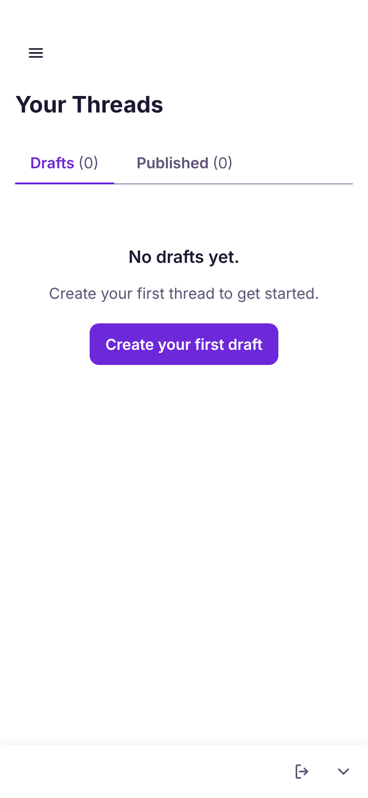

# Purple is the default look again

- Everyone sees the purple look and the plain components again, on every page.
- The Rare UI look stays available to the admin, as a choice on the feature flags page.

Area: Design
Link: https://github.com/Shaked/x-thread-draft-tool/pull/613

## Technical details

Owner decision of 2026-11-27 on #406 and #558: purple is the default. `src/utils/skin.js` and `server/admin/flags.js` list `default` first again; a non-admin always reads `default`. `index.html` paints Rare UI only on a device that last saw the admin with `xt-skin` set to `rare`. The admin's account stores a choice only when it is set, so an admin who chose Rare UI explicitly keeps it. The About page credit stays.
Tests that pinned Rare UI as the default are changed to pin purple (flags page, first paint, skin, flags API, UI audit, menu and editor specs). The new Rare UI cases of the audit keep their `skin` and `kit` seeds.
Screenshot: 
