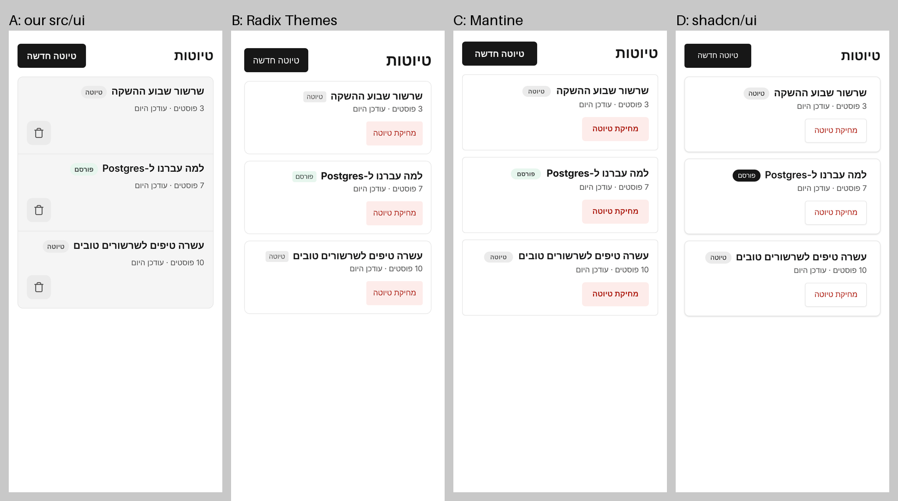
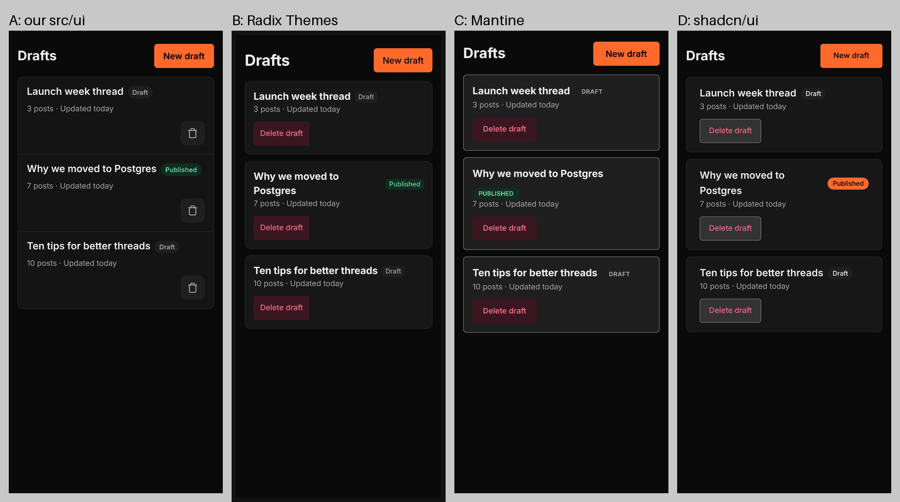
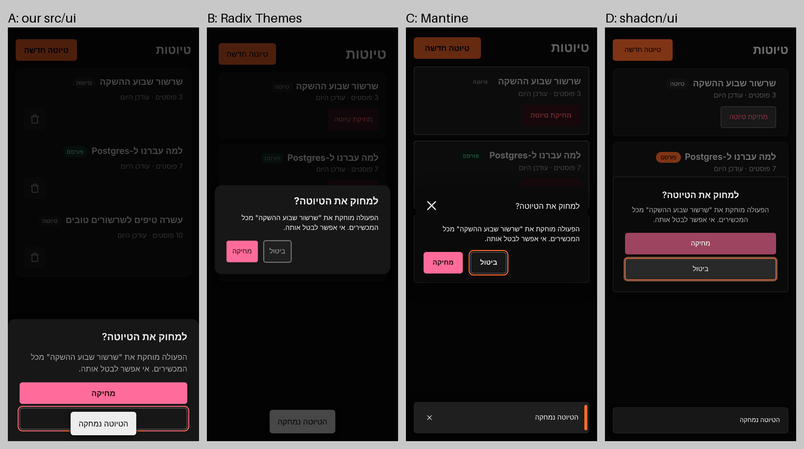
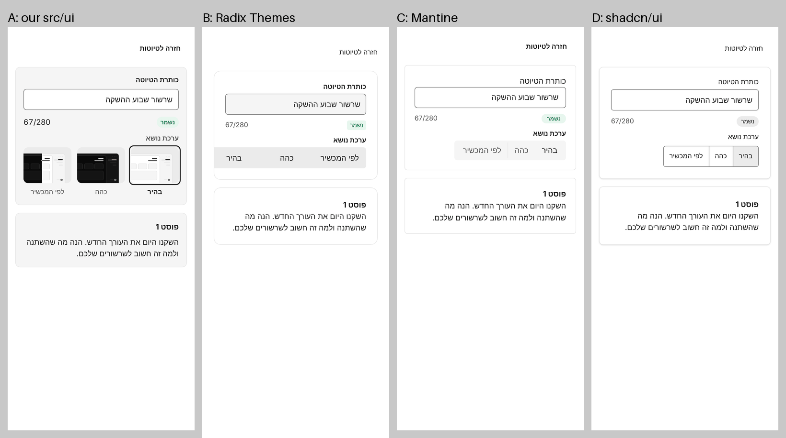
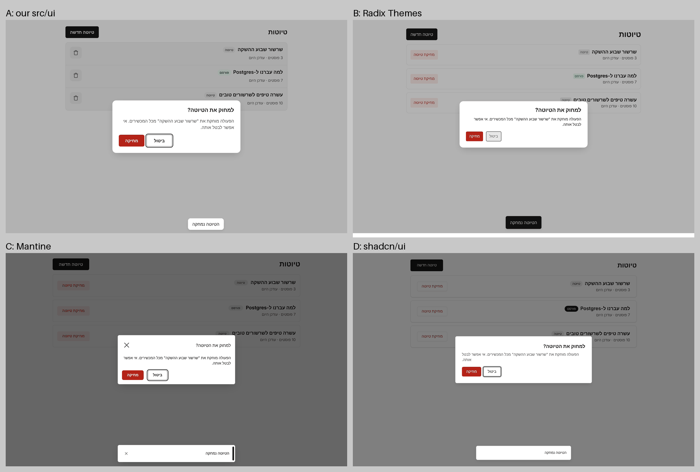
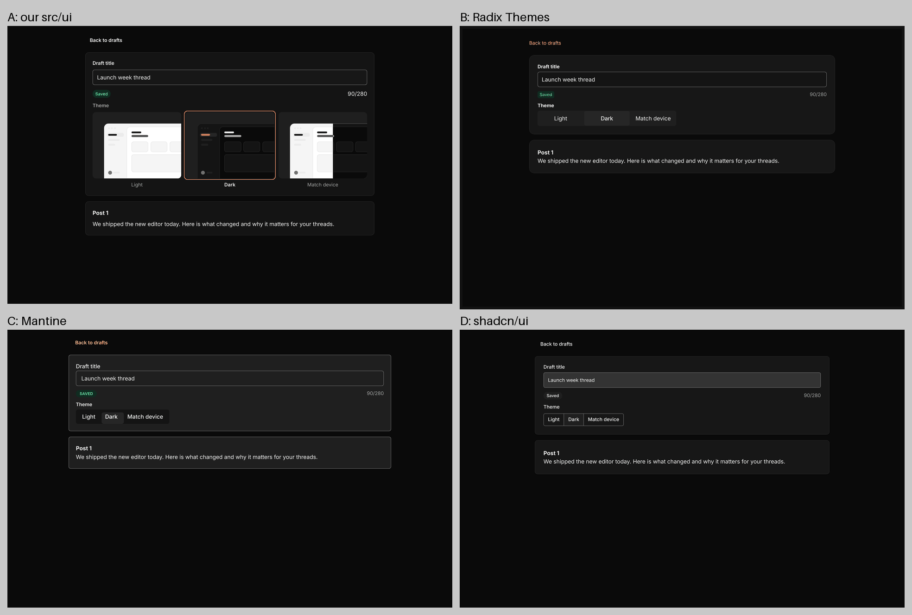

# UI components bake-off (#558)

Owner request, 2026-11-26 (Shaked): "I want nice UI components with the least changes needed token wise."
One criterion: how little must change in our tokens and components to get nice components on every page.
This file records the measurements. The owner picks the direction on #558. Nothing on `main` changed for this.

Measured by Opus on 2026-11-26. Spikes were built outside the repo (`/home/user/bakeoff/spike`, not committed).
Spike A copies `src/ui` from `main` at `e9df6aa`, before PR 513 (Rare UI toast) merged, so A shows our own toast.

## Candidates
- **A. Our own `src/ui`**, the Rare look by tokens (`data-skin="rare"`, PR 455), plus the Rare UI components already
  ported in #406 (theme selector, delete button, counter; `kit=rare`).
- **B. Radix Themes** 3.3.0 (styled components on CSS variables, no Tailwind).
- **C. Mantine** 8.3.18 (components themed with CSS variables, no Tailwind). Mantine 9 needs React 19.2 (see below).
- **D. shadcn/ui** `new-york-v4` sources (Radix based) on Tailwind 4.3.5: the base Rare UI is built on.
- **E. Headless primitives** (Radix Primitives, React Aria Components, Base UI): described, not built.

Each spike renders the same three screens from one content file, in English and Hebrew, light and dark:
the drafts list with a delete button, the delete dialog with a toast, and the editor header (title, save status,
the 280-character count, the theme setting). Every spike reads our `src/styles/tokens.css` with `data-skin="rare"`,
plus one alias file that maps our tokens onto the kit's variables.

## How it was measured
- **Size:** each spike is a Vite 8.3.6 production build with React 18.3.1. A Chromium page loads the drafts screen;
  every JS and CSS file it requests is gzipped at level 9 and summed (lazy chunks the page loads are included).
  Baselines: React 18 alone 45.0 kB; React 18 plus `react-router-dom` (which our `src/ui` uses) 57.6 kB.
- **axe:** `@axe-core/playwright` 4.14.0, tags WCAG 2.0, 2.1 and 2.2 A and AA. 16 runs per kit: the drafts screen
  at 390 and 1280 px, the dialog and editor at 1280 px, each in English and Hebrew, light and dark.
- **44 px targets:** every visible button, link, input and radio at 390 px under 44 px high or wide.
- **Reduced motion:** the dialog's computed animation and transition time with `prefers-reduced-motion: reduce`.
- **Focus:** keyboard: focus "Delete draft", Enter, Escape; focus must return to "Delete draft".
- **Screenshots:** 96 shots (4 kits, 3 screens, 390 and 1280 px, light and dark, English and Hebrew) at device scale 2,
  joined per variant into 24 sheets in `docs/screenshots/ui-bakeoff/` (390 px sheets at half size, 1280 px at 3/8).
  The `ui-debug` skill (#551) is not merged yet, so this used the same Playwright approach with the pre-installed Chromium.
- **Vendor facts:** the vendor sites (`www.radix-ui.com`, `mantine.dev`, `ui.shadcn.com`, `react-spectrum.adobe.com`,
  `base-ui.com`) did not resolve from this session. Facts below come from each vendor's own GitHub repository
  (docs sources), from the npm registry, and from the installed package, all read on 2026-11-26:
  `shadcn-ui/ui` at `0e5b2e6` (2026-11-25), `radix-ui/website` at `402e749` (2026-10-07),
  `radix-ui/themes` at `1faff10` (2026-04-11), `mantinedev/mantine` at `8f2ae60` (2026-11-23).
  Open issue counts: GitHub search, 2026-11-26.

## Scoring table
| Row | A: our `src/ui` | B: Radix Themes | C: Mantine | D: shadcn/ui |
|---|---|---|---|---|
| Token alias effort | 0 new lines: the Rare skin is 26 declarations in `tokens.css`, merged in PR 455 | 46 lines, 92 variables, plus 10 of our names redefined by the kit | 35 lines, 69 variables, plus 9 lines of theme code and 2 `aria-label` props | 38 lines, 41 variables, plus 9 changed lines in 6 copied component files |
| What cannot be mapped | nothing | 12-step grey and accent scales collapse onto our 5 surfaces (a selected segment was invisible until 1 more line); heights only through internal `rt-` class names | 10-step `dark-*` and `gray-*` palettes collapse; filled button text is set inline by JS, so it needs theme code; colour functions in JS cannot read CSS variables | `dark:` variants need a custom variant for `data-theme` (4 lines); Tailwind's own `--color-accent` means a hover grey, ours the brand |
| Name clashes with our tokens | none | `--space-1` to `--space-8` (24, 32, 48 px for 5, 6, 8), `--radius-full`, `--color-surface`, `--color-overlay`, set on `.radix-themes`, so they win inside it | none (all `--mantine-*`) | `--color-accent`, `--color-border`, `--radius-md`, `--font-sans`, `--font-mono` in Tailwind's theme layer; our unlayered tokens win |
| React 18 | yes | yes (peer 16.8 to 19) | 8.x only; 9.0 needs React 19.2 | written for React 19: focus did not return to "Delete draft" after Escape |
| Hebrew right to left | yes (logical properties, token lint) | no RTL page in its docs; its CSS has no logical properties; segmented control stays left to right in Hebrew | documented (`DirectionProvider`); correct in the screenshots | the CLI converts classes at install (`rtl: true`); by hand here: 3 classes; correct in the screenshots |
| Dark and light | yes, `light-dark()` tokens | yes through the alias | yes through the alias (127 dark-scheme selectors read `dark-*`) | yes through the alias plus the custom `dark` variant |
| Reduced motion | yes (dialog 0 s) | yes (dialog animation none) | no by default (`respectReducedMotion: false`); 1 line fixes it | no (dialog still 0.2 s); 1 rule fixes it |
| First load, drafts page (gzip) | 68.9 kB without the Rare components; 117.1 kB with them | 132.9 kB | 98.1 kB | 95.8 kB |
| Added over React 18 | 23.9 kB, router included (11.3 kB over React and router); the Rare components add 48.2 kB more (`motion` 43.0 kB) | 87.9 kB (CSS 58.2 kB) | 53.1 kB (CSS 12.4 kB) | 50.8 kB (CSS 7.4 kB) |
| Lazy loading | Rare parts lazy, but the delete button is on the drafts list, so `motion` loads there | JS tree-shaken; all component CSS is one file | per-component CSS files and tree-shaken JS | Tailwind emits only used classes; JS per component |
| axe (16 runs) | 0 violations | 0 violations | 0 after fixes; before: white text on the orange dark accent, 2 unnamed close buttons | 0 violations |
| 44 px targets at 390 px | pass | 32 to 40 px by default; 5 override rules; the text input is 42 px inside its 44 px frame | 28 to 42 px by default; 3 override rules | 36 to 40 px by default; 4 height edits in the copied source |
| Licence and credit | ours; Rare UI parts: MIT + Commons Clause + Attribution, visible link to rareui.com | MIT, keep the notice | MIT, keep the notice | MIT, keep the notice; `class-variance-authority` Apache-2.0, `lucide-react` ISC |
| Build tools | none new (Tailwind utilities only, already on `main` for the Rare parts) | none | none for its CSS; its docs ask for PostCSS to write our own CSS with its mixins | Tailwind 4 theme and reset for the whole app, `tw-animate-css`, `shadcn` |
| Our 30 `src/ui` components it replaces | none (it is them) | 18; no toast (used Radix Primitives' toast and 2 rules), no date picker, no charts | about 20, toast included; date picker and charts are extra packages | 18, toast, empty state and field included; date picker and charts in the registry |
| Last release, open issues | ours | 3.3.0 on 2026-01-31, last commit 2026-04-11, 156 open | 9.8.2 on 2026-11-20 (8.x last 8.3.18 on 2026-03-17), 20 open | CLI 4.23.1 on 2026-11-25, last commit 2026-11-25, 751 open |

Every size, count and result in the table was measured or read in this session (checked). Not checked: the size of
the date picker and chart add-ons, and how each kit behaves on pages other than these three screens.

## Screenshots
Each sheet shows A, B, C and D side by side for one variant. All 24 are in `docs/screenshots/ui-bakeoff/`
(`<screen>-<en|he>-<light|dark>-<390|1280>.png`).

| | |
|---|---|
|  |  |
|  |  |
|  |  |

## Findings per candidate
### A. Our own `src/ui`
- The Rare look on every page needs no new token line: every page already uses `src/ui`, and the Rare skin is 26
  token declarations (PR 455). The open work is the default switch, which #406 is doing.
- The Rare components cost the most bytes: with the Components flag on, the drafts page loads 48.2 kB more (checked),
  43.0 kB of it `motion`, because the Rare delete button is on that page. The #406 decision of 2026-11-26 sets
  30 kB as the point to report and propose a fix. A CSS-only delete-button animation would remove `motion` from it.

### B. Radix Themes
- Ten of our token names are redefined on `.radix-themes` with other values: `--space-5`, `--space-6` and `--space-8`
  are 24, 32 and 48 px there and 20, 24 and 32 px in ours. Our components inside a Radix `Theme` would change size.
- The segmented control stays left to right in Hebrew, and at 390 px "Match device" is cut off in English (checked).
- Its CSS is the largest: 58.2 kB gzip with the lean imports its release notes document (84.8 kB with `styles.css`).
- The last release is 10 months old (2026-01-31).

### C. Mantine
- No name clashes and the smallest set of fixes outside the alias, but those fixes are JS theme code, not tokens.
- Mantine 9 needs React 19.2 (its 9.0.0 changelog). On React 18 we stay on 8.3.18, last released 2026-03-17.

### D. shadcn/ui
- The fewest alias variables (41) and the smallest added size (50.8 kB), and it is the base Rare UI builds on.
- Its components have had no `forwardRef` since its 2025-02 changelog ("We've removed the forwardRefs").
  On React 18, a `ref` on them is dropped: after Escape, focus went to the page, not back to "Delete draft" (checked).
  It needs either React 19 or `forwardRef` added back in the copied `Button`.
- It brings Tailwind's theme and reset to the whole app and its own meaning of `accent`. `bg-destructive` passed as a
  class to `AlertDialogAction` lost to `bg-primary` (the `variant` prop works): a trap for copy-and-edit work.
- Base UI is now its default base (changelog 2026-07-02); the `new-york-v4` Radix sources used here are still supported.

### E. Headless primitives (described, not built)
| | Radix Primitives (`radix-ui`) | React Aria Components | Base UI (`@base-ui/react`) |
|---|---|---|---|
| Licence | MIT (checked, repository) | Apache-2.0: keep the licence and notice (checked, repository) | MIT (checked, repository) |
| React 18 | yes, peer 16.8 to 19 (checked, npm) | yes, peer 16.8 to 19 (checked, npm) | yes, peer 17 to 19 (checked, npm) |
| Right to left | `Direction` provider documented (checked, `radix-ui/website`) | not checked | not checked |
| Last release, open issues | 1.8.1 on 2026-10-12, 145 open | 1.22.1 on 2026-10-09, 555 open (`adobe/react-spectrum`) | 1.9.0 on 2026-10-09, 357 open |
| Size | not measured | not measured | not measured |

They bring behaviour only (focus, keys, positioning), so token effort is zero: our CSS styles them. They fit A as the
engine for a future menu, popover or date picker, not as a new look.

## Recommendation
**A, our own `src/ui` with the Rare look by tokens**, because it is the only option with zero new token lines and it
already reaches every page. Cheapest path to the Rare look on every page by default:
1. Make `data-skin="rare"` the default (the #406 common part: the admin switch stays).
2. Keep the Rare components that are cheap (theme selector 1.7 kB, counter 1.2 kB, both lazy, plus 2.7 kB of shared
   Tailwind CSS), and give the delete button a CSS animation so `motion` (43.0 kB) leaves the drafts page.
3. Use a headless primitive (E) only when we build a component we lack, such as a date picker.

**Fallback, if the owner wants a full ready-made kit:** D, shadcn/ui, because it maps with the fewest variables and is
the base of Rare UI. It needs React 19 (or `forwardRef` patches), Tailwind's theme across the app, and a page-by-page
move from `src/ui`. Not recommended: B (name clashes, right-to-left defect, old release) and C (React 18 line frozen,
fixes in JS theme code).

## What happens to the merged Rare UI work (PRs 455, 471, 494, 501, 513)
| Choice | PR 455 Rare look (tokens) | PRs 471, 494, 501, 513 (theme selector, delete button, counter, toast) |
|---|---|---|
| A (recommended) | becomes the default for everyone | stay; 494 gets a CSS animation instead of `motion`; Tailwind stays limited to `src/ui/rare/` |
| D shadcn/ui | stays: the alias feeds shadcn's variables | stay and fit better (same base); later re-copied closer to upstream once Tailwind's theme is global |
| B Radix Themes | stays, but needs the `--xt-*` second names to survive the clashes | stay as islands next to Radix; two systems to keep |
| C Mantine | stays: the alias feeds `--mantine-*` | stay as islands; Tailwind and `motion` remain only for them |

## Alias files (as measured)
The full files the measurements used. The spike sources are not committed.

<details><summary>B: Radix Themes alias (`alias.css`)</summary>

```css
/* Spike B alias: our tokens (src/styles/tokens.css, data-skin="rare") onto Radix Themes 3.3 variables. */
/* Radix Themes defines 13 names that we also use, with other values, on .radix-themes. Ours are read here under a */
/* second name first, so the alias can still reach them. */
:root { --xt-surface: var(--color-surface); --xt-overlay: var(--color-overlay); }
.radix-themes {
  --default-font-family: var(--font-sans);
  --code-font-family: var(--font-mono);
  --color-background: var(--color-bg);
  --color-panel-solid: var(--color-surface-raised);
  --color-panel-translucent: var(--color-surface-raised);
  --color-surface: var(--xt-surface);
  --color-overlay: var(--color-scrim);
  --radius-1: var(--radius-sm); --radius-2: var(--radius-sm); --radius-3: var(--radius-md);
  --radius-4: var(--radius-lg); --radius-5: var(--radius-xl); --radius-6: var(--radius-xl);
  --shadow-2: var(--shadow-sm); --shadow-3: var(--shadow-md); --shadow-4: var(--shadow-md);
  --shadow-5: var(--shadow-lg); --shadow-6: var(--shadow-lg);
  --gray-1: var(--color-bg); --gray-2: var(--color-surface); --gray-3: var(--color-surface-2);
  --gray-4: var(--color-surface-2); --gray-5: var(--color-border-soft); --gray-6: var(--color-border-soft);
  --gray-7: var(--color-border); --gray-8: var(--color-border); --gray-9: var(--color-text-soft);
  --gray-10: var(--color-text-soft); --gray-11: var(--color-text-soft); --gray-12: var(--color-text);
  --gray-a1: var(--color-surface); --gray-a2: var(--color-surface); --gray-a3: var(--color-surface-2);
  --gray-a4: var(--color-surface-2); --gray-a5: var(--color-border-soft); --gray-a6: var(--color-border-soft);
  --gray-a7: var(--color-border); --gray-a8: var(--color-border); --gray-a9: var(--color-text-soft);
  --gray-a10: var(--color-text-soft); --gray-a11: var(--color-text-soft); --gray-a12: var(--color-text);
  --gray-contrast: var(--color-bg); --gray-surface: var(--color-surface); --gray-indicator: var(--color-text-soft);
  --accent-1: var(--color-bg); --accent-2: var(--color-accent-soft); --accent-3: var(--color-accent-soft);
  --accent-4: var(--color-accent-soft); --accent-5: var(--color-accent-soft); --accent-6: var(--color-border-soft);
  --accent-7: var(--color-border); --accent-8: var(--color-focus); --accent-9: var(--color-accent);
  --accent-10: var(--color-accent-hover); --accent-11: var(--color-accent-soft-text); --accent-12: var(--color-text);
  --accent-a1: var(--color-bg); --accent-a2: var(--color-accent-soft); --accent-a3: var(--color-accent-soft);
  --accent-a4: var(--color-accent-soft); --accent-a5: var(--color-accent-soft); --accent-a6: var(--color-border-soft);
  --accent-a7: var(--color-border); --accent-a8: var(--color-focus); --accent-a9: var(--color-accent);
  --accent-a10: var(--color-accent-hover); --accent-a11: var(--color-accent-soft-text); --accent-a12: var(--color-text);
  --accent-contrast: var(--color-text-on-accent); --accent-surface: var(--color-accent-soft);
  --accent-indicator: var(--color-accent); --accent-track: var(--color-accent);
  --focus-8: var(--color-focus); --focus-a8: var(--color-focus);
  --red-9: var(--color-danger); --red-10: var(--color-danger-hover); --red-11: var(--color-danger);
  --red-a3: var(--color-danger-soft); --red-a4: var(--color-danger-soft); --red-a5: var(--color-danger-soft);
  --red-a11: var(--color-danger); --red-contrast: var(--color-text-on-danger); --red-a8: var(--color-danger);
  --green-a3: var(--color-success-soft); --green-a11: var(--color-success); --green-11: var(--color-success);
}
/* Not in Radix Themes: a toast. Radix Primitives' Toast, styled by our tokens. */
.spike-toast-viewport { position: fixed; inset-block-end: var(--space-4); inset-inline: var(--space-4); z-index: var(--z-toast); list-style: none; margin: 0; padding: 0; display: grid; justify-items: center; }
.spike-toast { background: var(--color-text); color: var(--color-bg); border-radius: var(--radius-md); padding: var(--space-3) var(--space-4); box-shadow: var(--shadow-md); font-family: var(--font-sans); }
/* 44 px targets on phones and touch screens: Radix sizes read its own --space-N, so set the heights from ours. */
.radix-themes .rt-BaseButton { --base-button-height: var(--control-h-sm); }
.radix-themes .rt-BaseButton:where(.rt-r-size-3, .rt-r-size-4) { --base-button-height: var(--control-h-md); }
.radix-themes .rt-TextFieldRoot { --text-field-height: var(--control-h-md); }
.radix-themes .rt-SegmentedControlRoot { height: var(--control-h-md); }
.radix-themes .rt-BaseButton.rt-variant-ghost { min-block-size: var(--control-h-sm); }
.radix-themes .rt-SegmentedControlRoot { --segmented-control-indicator-background-color: var(--color-accent-soft); }
```
</details>

<details><summary>C: Mantine alias (`alias.css`)</summary>

```css
/* Spike C alias: our tokens (src/styles/tokens.css, data-skin="rare") onto Mantine 8.3 variables. */
/* MantineProvider writes its variables at run time on :root[data-mantine-color-scheme], so this needs one more class of weight. */
:root:root[data-mantine-color-scheme] {
  --mantine-font-family: var(--font-sans); --mantine-font-family-headings: var(--font-sans); --mantine-font-family-monospace: var(--font-mono);
  --mantine-color-body: var(--color-bg); --mantine-color-text: var(--color-text); --mantine-color-bright: var(--color-text);
  --mantine-color-dimmed: var(--color-text-soft); --mantine-color-placeholder: var(--color-text-soft);
  --mantine-color-anchor: var(--color-accent); --mantine-color-error: var(--color-danger);
  --mantine-color-default: var(--color-surface-raised); --mantine-color-default-hover: var(--color-surface-2);
  --mantine-color-default-color: var(--color-text); --mantine-color-default-border: var(--color-border);
  --mantine-primary-color-filled: var(--color-accent); --mantine-primary-color-filled-hover: var(--color-accent-hover);
  --mantine-primary-color-light: var(--color-accent-soft); --mantine-primary-color-light-hover: var(--color-surface-2);
  --mantine-primary-color-light-color: var(--color-accent-soft-text); --mantine-primary-color-contrast: var(--color-text-on-accent);
  --mantine-color-red-filled: var(--color-danger); --mantine-color-red-filled-hover: var(--color-danger-hover);
  --mantine-color-red-light: var(--color-danger-soft); --mantine-color-red-light-hover: var(--color-danger-soft);
  --mantine-color-red-light-color: var(--color-danger); --mantine-color-red-text: var(--color-danger);
  --mantine-color-green-light: var(--color-success-soft); --mantine-color-green-light-color: var(--color-success);
  --mantine-color-blue-filled: var(--color-accent); --mantine-color-blue-filled-hover: var(--color-accent-hover);
  --mantine-color-blue-light: var(--color-accent-soft); --mantine-color-blue-light-hover: var(--color-surface-2);
  --mantine-color-blue-light-color: var(--color-accent-soft-text); --mantine-color-blue-text: var(--color-accent);
  --mantine-color-blue-outline: var(--color-accent); --mantine-color-blue-outline-hover: var(--color-accent-soft);
  --mantine-color-gray-light: var(--color-surface-2); --mantine-color-gray-light-color: var(--color-text-soft);
  --mantine-radius-xs: var(--radius-sm); --mantine-radius-sm: var(--radius-md); --mantine-radius-md: var(--radius-md);
  --mantine-radius-lg: var(--radius-lg); --mantine-radius-xl: var(--radius-xl); --mantine-radius-default: var(--radius-md);
  --mantine-shadow-xs: var(--shadow-sm); --mantine-shadow-sm: var(--shadow-sm); --mantine-shadow-md: var(--shadow-md);
  --mantine-shadow-lg: var(--shadow-lg); --mantine-shadow-xl: var(--shadow-lg);
  /* Dark-scheme rules in Mantine's CSS (127 selectors) read the dark-N palette; light rules read gray-N. */
  --mantine-color-dark-0: var(--color-text); --mantine-color-dark-1: var(--color-text); --mantine-color-dark-2: var(--color-text-soft);
  --mantine-color-dark-3: var(--color-text-soft); --mantine-color-dark-4: var(--color-border); --mantine-color-dark-5: var(--color-border-soft);
  --mantine-color-dark-6: var(--color-surface-2); --mantine-color-dark-7: var(--color-surface); --mantine-color-dark-8: var(--color-surface);
  --mantine-color-dark-9: var(--color-bg);
  --mantine-color-gray-0: var(--color-surface); --mantine-color-gray-1: var(--color-surface); --mantine-color-gray-2: var(--color-surface-2);
  --mantine-color-gray-3: var(--color-border-soft); --mantine-color-gray-4: var(--color-border); --mantine-color-gray-5: var(--color-border);
  --mantine-color-gray-6: var(--color-text-soft); --mantine-color-gray-7: var(--color-text-soft); --mantine-color-gray-8: var(--color-text);
  --mantine-color-gray-9: var(--color-text);
}
/* 44 px targets on phones and touch screens: Mantine sets its sizes on each component's root class. */
:root .mantine-Button-root { --button-height-sm: var(--control-h-sm); --button-height-md: var(--control-h-md); }
:root .mantine-Input-wrapper { --input-height-sm: var(--control-h-sm); --input-height-md: var(--control-h-md); }
:root .mantine-CloseButton-root { --cb-size-md: var(--hit-min); }
```

Plus the theme code in `main.jsx`:

```js
const mantineTheme = createTheme({
  respectReducedMotion: true,
  components: {
    Button: Button.extend({
      vars: (_theme, props) => (!props.variant || props.variant === 'filled'
        ? { root: { '--button-color': props.color === 'red' ? 'var(--color-text-on-danger)' : 'var(--color-text-on-accent)' } } : { root: {} })
    })
  }
})
```
</details>

<details><summary>D: shadcn/ui alias (`alias.css`)</summary>

```css
/* Spike D alias: our tokens (src/styles/tokens.css, data-skin="rare") onto shadcn/ui (new-york-v4) and Tailwind 4. */
@import "tailwindcss";
@import "tw-animate-css";
@import "shadcn/tailwind.css";
@source "./";

/* Our theme is data-theme on <html> (light, dark or system), not a .dark class. */
@custom-variant dark {
  &:where([data-theme=dark], [data-theme=dark] *) { @slot; }
  @media (prefers-color-scheme: dark) { &:where([data-theme=system], [data-theme=system] *) { @slot; } }
}

:root {
  --background: var(--color-bg); --foreground: var(--color-text);
  --card: var(--color-surface-raised); --card-foreground: var(--color-text);
  --popover: var(--color-surface-raised); --popover-foreground: var(--color-text);
  --primary: var(--color-accent); --primary-foreground: var(--color-text-on-accent);
  --secondary: var(--color-surface-2); --secondary-foreground: var(--color-text);
  --muted: var(--color-surface); --muted-foreground: var(--color-text-soft);
  --accent: var(--color-surface-2); --accent-foreground: var(--color-text);
  --destructive: var(--color-danger);
  --border: var(--color-border-soft); --input: var(--color-border); --ring: var(--color-focus);
  --radius: var(--radius-md);
}

/* From shadcn's manual install (docs/installation/manual): the Tailwind names its classes use. */
@theme inline {
  --color-background: var(--background); --color-foreground: var(--foreground);
  --color-card: var(--card); --color-card-foreground: var(--card-foreground);
  --color-popover: var(--popover); --color-popover-foreground: var(--popover-foreground);
  --color-primary: var(--primary); --color-primary-foreground: var(--primary-foreground);
  --color-secondary: var(--secondary); --color-secondary-foreground: var(--secondary-foreground);
  --color-muted: var(--muted); --color-muted-foreground: var(--muted-foreground);
  --color-accent: var(--accent); --color-accent-foreground: var(--accent-foreground);
  --color-destructive: var(--destructive);
  --color-border: var(--border); --color-input: var(--input); --color-ring: var(--ring);
  --radius-sm: calc(var(--radius) * 0.6); --radius-md: calc(var(--radius) * 0.8);
  --radius-lg: var(--radius); --radius-xl: calc(var(--radius) * 1.4);
}
@layer base {
  * { @apply border-border outline-ring/50; }
  body { @apply bg-background text-foreground; font-family: var(--font-sans); }
}
/* tw-animate-css and the copied components do not stop for reduced motion. */
@media (prefers-reduced-motion: reduce) { [data-slot] { animation-duration: 0s; transition-duration: 0s; } }
```

Source edits in the copied files: `h-9` and `h-10` to `h-(--control-h-sm)` and `h-(--control-h-md)` in `button`, `input`
and `toggle`; `border-l-0`, `rounded-l-md` and `rounded-r-md` to logical classes in `toggle-group`; `next-themes`
replaced by our theme in `sonner`; 2 import paths.
</details>
