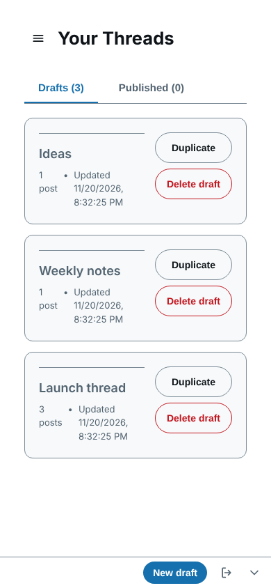
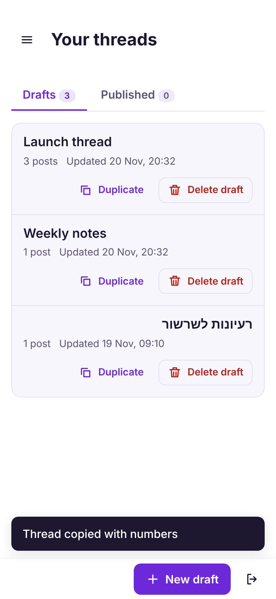
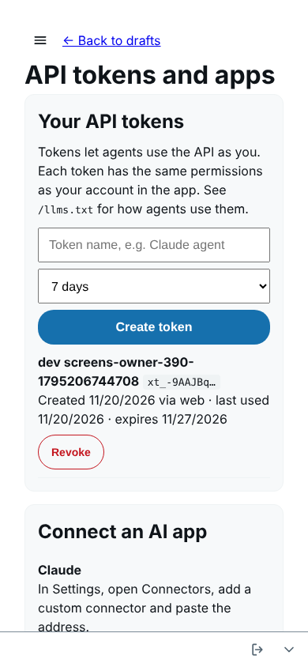
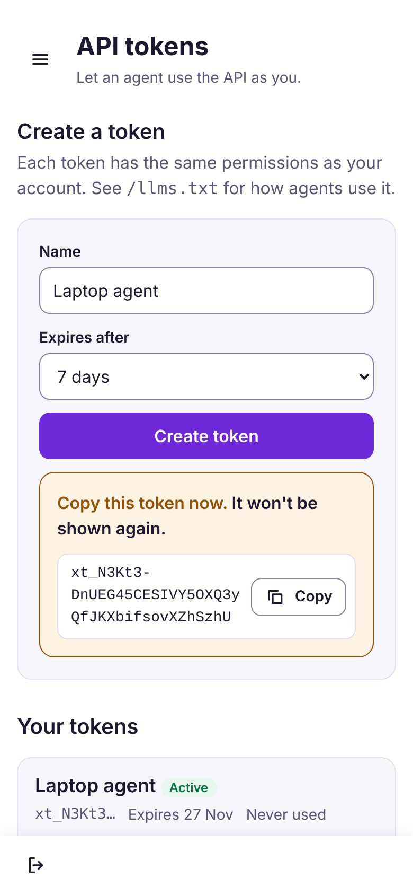
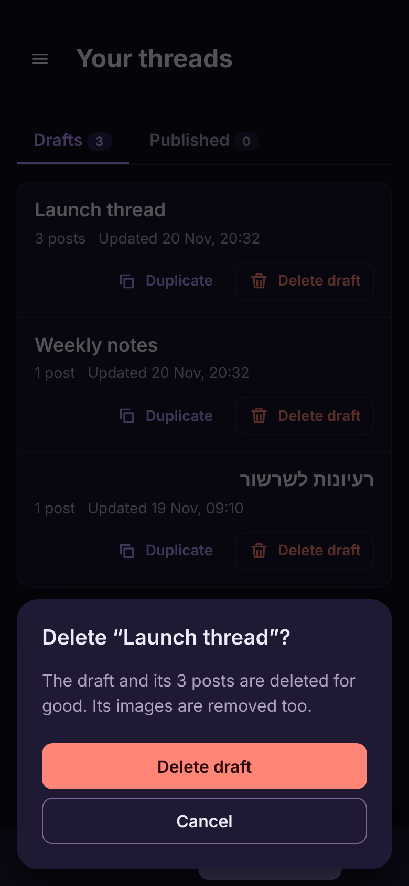

# Plan: one purple design system for every page (task U0, #305)

Epic #273. Owner request, 2026-11-20 (Shaked): "Purplish, aligned across all pages, including margins, paddings,
font sizes. Templated, not vibe-coded ... Components that only get configuration injected. Also a skill that knows
how to do designs and UI ... No significant change in features, it should be clearer ... what happens when I click
something, the width, the spacing around things should be beautiful."

Planner: Opus, effort high, 2026-11-20. Code read on `main` at e575ed8. No product code changes in this PR.

Files of this plan:
- `docs/plans/ui-design-system/tokens.css`: the proposed token file. Task 1 copies it to `src/styles/tokens.css`.
- `docs/plans/ui-design-system/mockup.html`: a static mock-up built only from those tokens (`?screen=tokens|drafts|dialog&theme=light|dark`).
- `docs/screenshots/ui-design-system/`: `before-*` (today, from `npm run screens`) and `mockup-*` (the proposed look).

## The proposed look (2 or 3 screenshots, as #305 asks)
| Today | Proposed |
|---|---|
|  |  |
|  |  |
| (today a delete asks with the browser's own `confirm()` box) |  |

More: `mockup-tokens-dark-1280.png`, `mockup-drafts-light-1280.png`, `mockup-drafts-dark-390.png`, `mockup-dialog-light-1280.png`.
The mock-up text is an illustration. Migration PRs keep today's words (see "Rules for every migration PR").

## 1. Audit (from the code in `src/`)

### 1.1 Summary
- One stylesheet, `src/styles/App.css`: 1754 lines, 331 rules, 177 class names. 19 of those classes are used by no
  file in `src/` (dead): `app-content app-header char-count char-limit character-counter preview-char-count
  preview-empty preview-placeholder preview-tweet preview-tweet-content preview-tweet-header preview-tweet-number
  preview-tweets thread-preview tweet-input tweet-input-wrapper user-info warning` (and `twitter-tweet`, which the
  X widget uses, so it stays).
- Colour tokens exist (`--bg`, `--accent` ...), but they are written **three times** (light, dark, and dark again
  inside the `system` media query). The accent is X blue (`#1670ad` light, `#1d9bf0` dark).
- Spacing tokens `--space-1..6` and `--radius`, `--radius-sm` exist but are used only **4 times** (the theme
  setting). Everything else is a raw pixel value.
- Distinct raw values: **16 font sizes** (12, 13, 14, 15, 16, 18, 20, 22, 24, 28, 32 px, 1, 1.5, 1.6, 2 rem, 0),
  **11 radii** (4, 6, 8, 12, 16, 20, 22, 24 px, 50%, `12px 12px 0 0`, the token), **32 paddings**, **9 gaps**,
  **11 different transitions** (`all 0.2s` alone is used 11 times), 2 box shadows, 4 z-index values (10, 100, 200, 1000).
- Raw colours outside the token blocks: `.grant-revoke-btn` uses `#f4212e` (the DARK danger red) in both themes;
  in light mode that is 3.9:1 on the card, under 4.5:1. `.app-menu-scrim` and `.app-menu` use `rgba(0,0,0,…)`.
- Contrast under 4.5:1 today (light theme): the Publish button, white text on `--success` `#00a06d` = 3.36:1;
  the "Saved" status, `#00a06d` on white = 3.36:1; carousel dots `--neutral-600` on white = 2.94:1.
  (`tests/unit/contrast.test.js` does not check `success`, so it passes.)
- Inline styles: 3 (`PostBox` textarea `overflow: hidden`, `ImageUpload` hidden file input, `XThreadPreviewPage` iframe).
- Native dialogs: 11 calls of `alert()` / `confirm()` in 4 files (`DraftList`, `ExportOptions`, `DraftEditor`, `TokensPage`).
- Physical (not logical) CSS (`left`, `right`, `margin-left`, `border-left`, `text-align: left/right`) in 18 rules:
  `.carousel-*` (7), `.remove-image-btn`, `.share-menu`, `.share-tooltip`, `.share-menu-item`, `.login-features`,
  `.emoji-picker-container`, the two `.theme-segment + .theme-segment` rules, and 2 dead `[dir]` rules. The menu
  drawer is already mirrored for `dir=rtl`.
- Focus rings: the same `outline: 2px solid var(--focus)` is written 10 times, per page or component, some with
  offset `2px`, some `-2px`. The draft list tabs have none (browser default).
- Bugs seen in the screenshots (`before-drafts-*`):
  - **Draft cards show a stray line and grey titles.** Two unrelated `.draft-info` rules collide: the editor's old
    sidebar rule (`border-top`, `padding-top: 15px`, `color: var(--muted)`) also styles the draft list.
  - **A draft card cannot be opened with the keyboard.** The card is a `<div onClick>`, not a link.
  - Phones: the meta line wraps into three lines ("1 / post · Updated / 11/20/2026, / 8:32:25 PM").
  - `.btn { width: 100% }` under 768 px makes every `.btn` full width, including ones inside rows.
  - The tabs have no `role="tab"` / `aria-selected`.

### 1.2 Per page and component
Values are the raw values in the rules each file's classes use. **Bold** = a one-off (used once in the whole stylesheet,
or a raw colour).

| File | Colour | Font size / weight | Spacing (padding, margin, gap) | Radius | Shadow | Control sizes |
|---|---|---|---|---|---|---|
| `App.jsx` (shell, loading) | `--muted` | inherits | 20, 15 (≤768), 40; **bottom `calc(var(--bar-space) + 16px)`** | — | — | page max 1400 px |
| `pages/DraftEditor.jsx` (header, hint, published, error screens) | `--accent` `--success` `--warning` `--danger` tints | 14, 16, 18, **22**, 24 / 600 | 12 20, 8 12 (phone), **0 -20px**, 20, 15, **gap 20**, **8 10** | 6, 8, 12, 16, 20 | — | title input 44; publish 44 (32 in bar); header `100vw` |
| `pages/TokensPage.jsx` | **`#f4212e`, `#f4212e20`** (revoke), `--warning*` | 13, 14, 15, 16, 18 / 600 | 16, 12, 10 0, **2 6**, **4 8**, **margin 4 0, 12 0 0, 12 0 4, 16 0 0**, **padding-inline-start 20** | 4, 6, 8, 12, 22 | — | form controls 44; copy **48**; revoke 44 |
| `pages/AboutPage.jsx` | `--text-soft` | 16, 18 | 12, 16, **gap 6 16**, **margin 16, 24** | 8 | — | copy 44/**48** (reuses `.tokens-page`, `.connected-apps`) |
| `pages/ChangelogPage.jsx` | `--surface` `--text-soft` | 16, 18, 1rem / 600 | 12 16, **24 0 8**, **16 0**, **0 0 4** | 8, 12 | — | (reuses `.tokens-page`, `.copy-btn`) |
| `pages/XThreadPreviewPage.jsx` | `--muted` | — | same as App | — | — | **inline iframe style** |
| `components/DraftList.jsx` | `--accent` `--danger` tints | 1.6rem, 2rem, 12, 13, 14, 15, 16, 18 / 600, 700 | 10 20, 12 20, 15, 20, 30, **60 20**, **padding-top 15** (bug) | 4, 12, 16, 20, 22 | — | new draft 32 (bar) / auto; duplicate, delete 44 |
| `components/LoginPage.jsx` | `--accent` `--danger` | 1.6rem, 2rem, 13, 14, 16, 24 / 600 | **12 24**, 15, 20, **30 20**, 40, **margin-top 30** | 8, 16, **24** | — | sign-in button auto height (~46) |
| `components/AppBar.jsx` | `--surface` `--text-soft` | — | 0 4 + safe area, 8 | 8, **`12px 12px 0 0`** | `0 -1px 0` | bar 44; buttons **40** wide |
| `components/AppMenu.jsx` | **`rgba(0,0,0,0.5)`**, **`rgba(0,0,0,0.3)`** | 12, 14, 1rem | 8, 0 8, **8 8 0**, **8 8 calc(...)** | 8 | **`0 0 24px`** | items 44; menu button **40** |
| `components/ThemeSetting.jsx` | `--accent` | 14 | `--space-2 --space-4` (only token use) | `--radius-sm` | — | 44 |
| `components/ShareLinkButton.jsx`, `ExportOptions.jsx`, `AgentLinkButton.jsx`, `XThreadLinkButton.jsx` | `--accent` tooltip, `--surface` menu | 13, 14, 15 / 600 | 8 16, 8 12, **gap 6**, **margin 4 8** | 6, 8, 20 | — | 44; menu **min-width 180**; bar buttons **40** |
| `components/LogoutButton.jsx` | `--text-soft`, hover `--danger` border | 14 | 0 | 20 | — | 44 (40 in bar) |
| `components/CopyButton.jsx` | `--border-soft` hover | 16 (18 in token box) | 8 12 | 8 | — | 44 (**48** in token box) |
| `components/ThreadComposer.jsx` | `--surface` | 1.5rem, 14, 16, 18 / 500, 600, 700, `bold` | 20, **12 6** (phone), **10 16**, **margin 10 0** | 0, 8, 16, 20 | — | add/insert 44 |
| `components/PostBox.jsx` | overlays `--overlay-70/90` | 14, 16, 20, 24, **28** / 600 | 15, 10, **10 12**, **10 15**, 4, 8 | 4, 8, 12, 22, 50% | — | 44 everywhere; textarea **min-height 120**; carousel **min 300 / 200**, dots **8** |
| `components/ImageUpload.jsx` | `--accent` tints, `--danger` | 16, **32** | 20, 8 12, 12 | 6, 8 | — | **inline `display: none`** |
| `components/TweetEmbed.jsx` | `--surface`, `--accent` link | — | 15, 20, 10 | 8 | — | min-height 260 (phone) |
| `components/EmojiPicker.jsx` | (third-party picker) | — | margin 8 | — | — | **z-index 1000** |
| `components/Icon.jsx` | `currentColor` | — | — | — | — | **20 x 20** |

### 1.3 Server pages (outside `src/`, listed so nothing is forgotten)
- OAuth consent and device pages, `server/oauth/consent.js`: their own inline CSS, blue `#1d4ed8`, radius 6, system font. → Task 12.
- Share page, `server/share/render.js` (also shown by `/x-thread-preview/:token`): an X look-alike in X's dark colours
  on purpose (it shows how the thread will look on X). **Decision: it keeps the X look.** Only the preview page's own
  loading and error text use the tokens (Task 11).
- MCP views, `server/mcp/ui/*.js`: they follow the AI app's theme (#238 T10). **Out of scope**; the capability table keeps them as they are.

## 2. Design tokens
**One file:** `src/styles/tokens.css` (proposal: `docs/plans/ui-design-system/tokens.css`). No raw colour, length,
font, duration, easing, shadow or z-index value anywhere else in `src/` (the token lint, section 6, fails on one).

Decisions (planner):
- **Palette: purple accent, purple-tinted neutrals.** Accent violet `#6d28d9` (light) / `#b69cff` (dark). Neutrals
  have a slight violet hue (`#f8f6fd` surface, `#1d1730` text) so the whole page reads as one family. Status colours
  (danger, success, warning) are separate from the accent so a destructive button never looks like the brand.
- **Each colour is written once:** `--color-x: light-dark(<light>, <dark>)`. The theme only sets `color-scheme` on
  `<html>`: `light`, `dark`, or `light dark` for "Match device" (`data-theme="system"`, which `src/utils/theme.js`
  and `index.html` already set). This removes today's three copies. `light-dark()` is in Chrome 123, Firefox 120 and
  Safari 17.5 (from their release notes; not checked again in this session). Checked here: the pre-installed Chromium
  (`/opt/pw-browsers/chromium-1243`) resolves it; the mock-up screenshots are rendered with it.
- **Contrast** (all 102 pairs pass, 51 per theme; lowest 4.83:1 for text, success on `surface-2`, and 3.11:1 for a
  border on `surface-2`): text, soft text, accent, danger, success and warning on every surface; text on accent, on
  danger and on each soft background; borders and the focus ring at 3:1. The pair list is in section 6.
- **No web font.** The system font stack stays (fast, offline-safe PWA, no third-party request). Hebrew gets
  `Noto Sans Hebrew` if installed, else the system fallback.
- **Type scale:** 12, 14, 16, 18, 20, 24, 28 px (`--font-size-xs` … `--font-size-3xl`), weights 400/500/600/700,
  line heights 1.25 / 1.5 / 1.6. Body and every input are 16 px (iOS does not zoom a 16 px field). Page title 24 px
  on phones, 28 px from 768 px. A screen uses the title size plus at most three other sizes.
- **Space:** a 4 px grid: 0, 4, 8, 12, 16, 20, 24, 32, 40, 48, 64 (`--space-0` … `--space-16`).
- **Radii:** 6 (code, chips), 10 (buttons, inputs, menu items: the same, so a form row lines up), 14 (cards, lists,
  banners), 20 (dialogs, sheets), full (badges, round icon buttons). **Buttons are no longer pills**; they share the
  input radius.
- **Shadows:** three (`sm` raised row, `md` menus, toasts and the phone bar, `lg` dialogs and the drawer), stronger in dark mode.
- **Motion:** 120 ms (hover, press), 200 ms (menus, tabs, toasts), 280 ms (dialog, drawer). Easing
  `cubic-bezier(0.2, 0, 0, 1)` in, `cubic-bezier(0.3, 0, 1, 1)` out. Reduced motion sets every duration to 0 **in the
  token file only**, so no component needs its own media query.
- **Focus ring:** 2 px `--color-focus` outline, 2 px offset, on `:focus-visible` only, for every interactive element.
- **Sizes:** touch target 44 px (`--hit-min`); control heights 36 / 44 / 52 (36 becomes 44 on `pointer: coarse`);
  icons 20 / 24; phone bar 56 (today 44); page widths 640 (settings), 880 (lists, editor), 1200 (admin tables);
  gutter 16 px, 24 px from 768 px.
- **Breakpoints:** only 360, 600 and 768 px (custom properties cannot be used in media queries), always in range
  syntax: `(width < 768px)` or `(width >= 768px)`, so no width matches both sides. The lint accepts only these forms.
  Today the code uses `max-width` 359, 768, 1024 and `min-width` 600, and `max-width: 768px` and a `min-width: 768px`
  would both match at exactly 768.
- **Layers:** raised 1 (inside a component), sticky 100, phone bar 150, popover 300, drawer 400, dialog 500, toast 600.
- **Spinner and shimmer:** `--ease-linear`, `--duration-spin` (900 ms), `--duration-shimmer` (1500 ms); 0 under reduced motion.
- `src/utils/theme.js` writes `#000000` / `#ffffff` into `<meta name="theme-color">`. Task 1 makes it write the computed
  `background-color` of `<body>` instead (an `rgb(...)` string), so the tokens stay the only source. Visible result:
  the browser bar is `#100c1c` instead of black in dark mode. `index.html` keeps a literal `#ffffff` for the first
  paint; a unit test checks it equals the light `--color-bg`.
- **Old names in Task 1.** `App.css` already defines `--space-1..6`, `--radius`, `--radius-sm` and `--bar-h` with other
  values (`--space-5` is 24 there, 20 here; `--radius-sm` 8 vs 6; `--bar-h` 44 vs 56). Task 1 renames those old size
  variables in `App.css` to `--legacy-space-*`, `--legacy-radius*` and `--legacy-bar-h` (same values, so no size changes),
  and replaces the three old colour blocks with this alias block, so only the colours change:

  | Old | New | Old | New |
  |---|---|---|---|
  | `--bg` | `--color-bg` | `--accent-tint-10`, `--accent-tint-20` | `--color-accent-soft` |
  | `--surface-0` | `--color-surface-raised` | `--accent-tint-40` | `--color-accent` |
  | `--surface` | `--color-surface` | `--danger`, `--danger-hover` | `--color-danger`, `--color-danger-hover` |
  | `--surface-2` | `--color-surface-2` | `--danger-tint-20` | `--color-danger-soft` |
  | `--border`, `--border-strong`, `--neutral-600` | `--color-border` | `--success`, `--success-hover`, `--success-tint-40` | `--color-success` |
  | `--border-soft` | `--color-border-soft` | `--success-tint-10` | `--color-success-soft` |
  | `--text`, `--text-strong` | `--color-text` | `--warning`, `--warning-strong`, `--warning-tint-40` | `--color-warning` |
  | `--text-soft`, `--muted` | `--color-text-soft` | `--warning-tint-10` | `--color-warning-soft` |
  | `--accent`, `--accent-hover` | `--color-accent`, `--color-accent-hover` | `--focus` | `--color-focus` |
  | `--accent-text` | `--color-text-on-accent` | `--overlay-30`, `--overlay-70`, `--overlay-90`, `--on-overlay` | `--color-scrim`, `--color-overlay`, `--color-overlay-strong`, `--color-on-overlay` |

  Import order: `src/main.jsx` imports `./styles/tokens.css`, then `./ui/base.css`, then `./styles/App.css`
  (`App.jsx` stops importing `App.css` a second time). Publish stays green until Task 8 (white on `#067647` is 5.69:1;
  today it is 3.36:1).

## 3. Components (configuration only)
Where: `src/ui/<Name>.jsx` and, when it needs styles, `src/ui/<Name>.css` imported by the component. CSS class names
are `ui-<name>` and `ui-<name>--<variant>`. Components take no `className` prop (tests use roles, labels or
`data-testid`); **pages pass props, never CSS for layout or spacing.**
- Pages have no CSS file: `src/pages/**`, `src/components/DraftList.jsx`, `src/components/LoginPage.jsx`.
- Editor parts are domain components, not kit components: `ThreadComposer`, `PostBox`, `ImageUpload`, `TweetEmbed`,
  `EmojiPicker` and a new `src/components/ImageCarousel.jsx` (moved out of `PostBox.jsx`, where it is a local function
  today). Each may have one CSS file next to it (`PostBox.css` …), token values only, checked by the same lint. They
  use kit components (`IconButton`, `Button`, `Banner`) for every control.
- `src/ui/base.css` (Task 1) is the only global style: the box-sizing reset, `body` font and colours, the focus ring,
  and the resets for `h1-h6, p, ul, ol, dl, dd, fieldset, legend, button, input, select, textarea, a` (margin 0,
  `font: inherit`, `color: inherit`), so browser defaults (h1 margin 21.44 px, button font 13.33 px) never show.

The living list is `docs/architecture/ui-components.md` (Task 2 creates it from this section): name, file, props,
states, example, status (`built` or `not built: <reason>`). A unit test checks it against `src/ui/` (section 6).

A component is built **in the PR of the first page that uses it** (knip fails on an unused file), so the build order
follows the page order in section 5.

### Layout
| Component | Props | States / notes | Example |
|---|---|---|---|
| `Page` | `width: 'narrow'\|'default'\|'wide'` (640/880/1200), `children` | Centers, gutter, top padding 24, bottom padding leaves room for the phone bar (`--bar-space`). One per route. | `<Page width="narrow">…</Page>` |
| `PageHeader` | `title`, `subtitle?`, `back?: {to, label}`, `actions?: node` (goes into the AppBar), `menu = true`, `sticky = false`, `titleSlot?: node` (replaces the `h1`, e.g. the editor's title input; an `h1` stays for screen readers), `status?: node` (e.g. the editor's save status) | Menu button, title (`h1`), subtitle; actions are in the header from 768 px and in the fixed bottom bar below. Min height 64. Space 24 below. `sticky` keeps it at the top with `--z-sticky` and a bottom border (the editor). | `<PageHeader title="API tokens" subtitle="Let an agent use the API as you." actions={<Button …/>} />` |
| `Section` | `title`, `description?`, `actions?`, `children`, `headingLevel = 2` | `h2` + soft description; gap 16 inside, 32 between sections. `aria-labelledby` set from the title. | `<Section title="Your tokens">…</Section>` |
| `Card` | `children`, `padding: 'md'\|'none'`, `tone: 'default'\|'raised'` | Surface, 1 px soft border, radius 14, padding `--card-pad` (16, 20 from 768). | `<Card>…</Card>` |
| `Stack` | `gap: 1\|2\|3\|4\|6\|8` (default 3), `as`, `children` | Vertical flex. The only way to space siblings vertically. | `<Stack gap={4}>…</Stack>` |
| `Inline` | `gap` (default 2), `align: 'start'\|'center'\|'end'\|'between'`, `wrap = true`, `equal = false` | Horizontal row; `equal` gives each child the same width (button groups). | `<Inline align="end" equal>…</Inline>` |

### Actions
| Component | Props | States / notes | Example |
|---|---|---|---|
| `Button` | `variant: 'primary'\|'secondary'\|'ghost'\|'danger'\|'danger-quiet'`, `size: 'sm'\|'md'\|'lg'`, `icon?`, `loading`, `loadingLabel?`, `disabled`, `disabledReason?`, `fullWidth`, `type = 'button'`, `to?` / `href?` (renders a link that looks like a button), `onClick` | default, hover, pressed, focus-visible, disabled, loading (section 4). One `primary` per screen. | `<Button variant="primary" icon="plus" onClick={create}>New draft</Button>` |
| `IconButton` | `icon`, `label` (required: `aria-label` and tooltip `title`), `variant: 'ghost'\|'secondary'`, `pressed?` (toggle, sets `aria-pressed`), `disabled`, `disabledReason?` | 44 x 44 always; icon 20. | `<IconButton icon="menu" label="Menu" onClick={open} />` |
| `Menu` | `trigger: {label, icon?, variant}`, `items: [{label, onSelect, tone?: 'danger', description?}]`, `title?` | A button that opens a popover list (desktop) or a sheet above the phone bar (under 768 px). Arrow keys move, Escape closes, focus returns to the trigger. Replaces `.share-menu`. | `<Menu trigger={{label: 'Export', icon: 'export'}} items={…} />` |

### Forms
| Component | Props | States / notes | Example |
|---|---|---|---|
| `Field` | `label`, `help?`, `error?`, `children` (one control), `id?` | Label 14/600, 8 px to the control, help or error 14 px, 4 px under it. Wires `htmlFor`, `aria-describedby`, `aria-invalid`. | `<Field label="Name" help="Shown in your token list">…</Field>` |
| `Input` | `value`, `onChange`, `type`, `placeholder?`, `maxLength?`, `multiline?`, `rows?`, `dir = 'auto'`, `disabled`, `readOnly`, `invalid` | Height 44, 16 px text, radius 10; hover border accent; focus border accent + ring; invalid border danger. | `<Input value={name} onChange={setName} />` |
| `Select` | `value`, `onChange`, `options: [{value, label}]`, `disabled` | Same box as Input; native `<select>` (keeps phone pickers). | `<Select value={days} options={EXPIRY} onChange={setDays} />` |
| `Toggle` | `checked`, `onChange`, `label`, `description?`, `disabled` | A switch (`role="switch"`), 44 px row. **Not built: no page needs it yet.** First user builds it. | `<Toggle label="Include numbers" checked={on} onChange={setOn} />` |
| `SegmentedControl` | `legend`, `value`, `options: [{value, label}]`, `onChange`, `orientation: 'row'\|'column'` | Radio group (arrow keys work, as today's theme setting). Replaces `.theme-segments`. | `<SegmentedControl legend="Theme" options={THEMES} … />` |

### Content and data
| Component | Props | States / notes | Example |
|---|---|---|---|
| `List` / `ListItem` (one file) | List: `children`, `label?`. ListItem: `title`, `meta?: node[]`, `badge?`, `to?` (whole row is a link), `actions?: node`, `dir = 'auto'` on the title | Rows inside one card with 1 px dividers; padding 16; title 18/600; meta 14 soft with 12 px gaps (no "·" glyphs, so a wrap never leaves a dot alone); under 600 px the actions move to their own row, end-aligned. | `<ListItem title={d.title} to={`/draft/${d.id}`} meta={[…]} actions={…} />` |
| `Table` | `columns: [{key, label, align?, width?, render?}]`, `rows`, `rowKey`, `empty`, `loading`, `caption` | For admin pages. Real `<table>` from 768 px; under 768 px each row becomes a card of label/value pairs. Header 14/600 soft. Built by #286. | `<Table caption="Users" columns={COLS} rows={users} rowKey="id" />` |
| `DescriptionList` | `items: [{term, value}]`, `columns: 1\|2` | `<dl>` grid; terms soft. Replaces `.about-details`; used by admin user details. | `<DescriptionList items={[{term: 'Commit', value: sha}]} />` |
| `CodeBlock` | `code`, `copyLabel?` (shows a Copy button), `wrap = true` | Mono 14 px on `--color-bg`, radius 10; long values break anywhere. Replaces `.token-secret`, `.connect-app-row code`. | `<CodeBlock code={token} copyLabel="Copy" />` |
| `Badge` | `tone: 'accent'\|'neutral'\|'success'\|'warning'\|'danger'`, `children`, `live = false` | 12 px / 600, full radius, soft background. Text only, never the only signal. `live` wraps it in `role="status" aria-live="polite"` (the editor's "Saving… / Saved / Not saved", which keeps its texts and its tones warning, success, danger). | `<Badge tone="success">Active</Badge>` |
| `Banner` | `tone: 'info'\|'success'\|'warning'\|'danger'`, `title?`, `children`, `actions?`, `role` (`status` default, `alert` for errors) | Soft background, 1 px tone border, radius 14, padding 16. Replaces `.signed-out-note`, `.token-created`, `.login-error`, `.editor-hint`, `.published-badge`, page `.error`. | `<Banner tone="warning" title="Copy this token now.">…</Banner>` |
| `EmptyState` | `title`, `description?`, `action?` | Centered, 48 px padding, one action button. | `<EmptyState title="No drafts yet" action={<Button …>Create your first draft</Button>} />` |
| `Skeleton` | `lines = 3`, `variant: 'text'\|'row'\|'card'` | Shimmer that stops under reduced motion; `aria-busy` on the parent, one "Loading…" text for screen readers. Replaces "Loading…" text blocks. | `<Skeleton variant="row" lines={3} />` |
| `Tabs` | `tabs: [{id, label, count?}]`, `value`, `onChange`, `label` | `role="tablist"`, `tab`, `aria-selected`, arrow keys; 2 px accent underline. The count stays in the text as today, " (3)", in soft colour, so the tab's name stays "Drafts (3)". | `<Tabs label="Threads" tabs={…} value={tab} onChange={setTab} />` |

### Overlays
| Component | Props | States / notes | Example |
|---|---|---|---|
| `Dialog` | `open`, `onClose`, `title`, `description?`, `children?`, `actions: [{label, variant, onClick, autoFocus?}]`, `placement: 'center'\|'sheet-start'` (drawer), `dismissible = true` | Rendered in a portal on `document.body`, outside `#root`, because `#root` is made `inert` while it is open. Focus trap, Escape closes, focus returns to the opener, page behind does not scroll (the logic `AppMenu` has today moves here). Centered from 600 px, a bottom sheet below. `sheet-start` is the menu drawer (slides from inline start, so it mirrors in RTL). | see `useConfirm` |
| `useConfirm()` (in `Dialog.jsx`) | returns `confirm({title, body, confirmLabel, tone: 'danger'\|'primary'}) → Promise<boolean>` | Replaces every `window.confirm`. Cancel is focused first for a destructive action. | `if (!(await confirm({title: 'Delete this draft?', body: 'Are you sure you want to delete this draft?', confirmLabel: 'Delete draft', tone: 'danger'}))) return` |
| `Toast` + `useToast()` | `toast({message, tone: 'neutral'\|'success'\|'danger', action?})` | `ToastProvider` wraps the routes in `App.jsx`, so a toast survives a navigation (publish shows its message, then goes to `/`). Its live region is mounted empty at start, so the first message is announced. One at a time, bottom (above the phone bar), 4 s (errors stay until closed), `role="status"` (`alert` for danger). Replaces every `alert()` and the share tooltips. | `toast({message: 'Thread copied!', tone: 'success'})` |

### Icons
`Icon` stays and moves to `src/ui/Icon.jsx` in Task 2, with `name`, `size: 'md'\|'lg'`, `mirror` (flips in RTL
for arrows and chevrons). The emoji used as icons in the editor toolbar and login page (📷 🔗 😀 ✍️ …) become line icons
from the same set, so they share colour and size and work in dark mode. New icon paths: `plus, copy, trash, image,
link, emoji, back, check, alert`.

## 4. Details, decided per component
Rules that apply to every interactive component:
| Topic | Decision |
|---|---|
| Hover | Only inside `@media (hover: hover)`, so a tap on a phone never leaves a stuck hover colour. Primary: `--color-accent-hover`. Secondary and ghost: `--color-accent-soft` background, accent border. Danger-quiet: `--color-danger-soft`. List rows with `to`: `--color-surface-2`. 120 ms. |
| Pressed | `:active`: `transform: scale(var(--press-scale))` (0.98, 1 under reduced motion) and the pressed colour (`--color-accent-pressed` for primary). No ripple. |
| Focus-visible | `outline: 2px solid var(--color-focus); outline-offset: 2px` on every focusable thing, set once in `src/ui/base.css`. Inside a clipped list row the offset is -2 px. Never `outline: none` without this. |
| Disabled | Native `disabled` and `--opacity-disabled` (0.5), `cursor: not-allowed`, no hover. When the user should know why (#291 "Not available while viewing as <login>"), pass `disabledReason`: the button gets `aria-disabled="true"` instead (stays focusable), ignores clicks, and the reason is shown as help text linked by `aria-describedby` and as `title`. |
| Loading | `loading` keeps the button the same width: the label and `loadingLabel` sit in one grid cell, the inactive one `visibility: hidden`. A 16 px spinner replaces the icon. `aria-busy="true"`, clicks ignored. Today's texts stay as the `loadingLabel` ("Creating…", "Redirecting to GitHub…"). |
| Touch target | Every button, link-as-button, tab, menu item, toggle and input is at least 44 x 44 on touch (`pointer: coarse`) and on any screen under 768 px. A small visual (an 8 px carousel dot, a 20 px icon) sits inside a 44 px box made with padding, so the element's own box is 44 (a pseudo-element hit area would not count). Inline text links inside a sentence are exempt (WCAG 2.2 target-size exception). One deliberate exception: the phone bar's "Show toolbar" tab is 44 wide and at most 36 high (`tests/e2e/app-bar.spec.ts` pins it); it is listed in the audit's `EXEMPT_TARGETS`. |
| Button width | Content width by default, min width 96 px only in dialog and form footers. `fullWidth` for the one main action of a narrow form. Under 600 px: dialog actions stack full width (the main action on top); a form row stacks its fields and its button full width. A group of equal choices uses `Inline equal`. Never `.btn { width: 100% }` globally. |
| Field spacing | Label → control 8 px; control → help or error 4 px; field → next field 16 px; last field → form actions 24 px. Label above the control, never placeholder-only. |
| Transitions | Name the properties (`background-color, border-color, color, transform, opacity`), never `all`. Hover and press: fast. Menus, tabs, toasts: base. Dialog and drawer: slow, enter with `--ease-standard`, exit with `--ease-exit`. Reduced motion: 0 through the tokens. |
| Right to left | Only logical properties (`margin-inline-start`, `padding-block`, `inset-inline-end`, `border-inline-start`, `text-align: start`); the lint fails on `left`, `right`, `margin-left` etc. User text (titles, posts, names, changelog) gets `dir="auto"`. Direction icons use `Icon mirror`. Counts like `1/3` are wrapped in `<bdi>`. The drawer opens from the inline start (already true for the menu). |
| Text overflow | Titles wrap (no ellipsis) except in the editor's title input; long codes and URLs break anywhere (`overflow-wrap: anywhere`). No horizontal page scroll at 320 px and up. |
| Colour meaning | Status is never colour alone: badges and banners have words; the over-limit counter keeps its number. |
| Dates | Draft list only (Task 6): `Intl.DateTimeFormat` in the browser's locale with `dateStyle: 'medium', timeStyle: 'short'`, in English "Nov 20, 2026, 8:32 PM" instead of "11/20/2026, 8:32:25 PM" (no seconds, so it fits one line on a phone). The other pages keep their own formats (`src/utils/version.js`, `TokensPage`, `ChangelogPage`). |

Per component, beyond the table:
- **Button.** Heights: sm 36 (44 on touch), md 44, lg 52. Padding inline 12 / 16 / 20. Icon gap 8. Text 16 (sm 14) / 600, no wrap.
- **IconButton.** Ghost by default; `pressed` shows `--color-accent-soft` (toolbar emoji, image and embed toggles).
- **Menu.** Popover 8 px below the trigger, aligned to its inline end, width 220, radius 14, `shadow-md`, items 44 high.
  Under 768 px a sheet above the bar (today's behaviour). Opens in 200 ms (fade + 4 px slide), closes in 120 ms.
- **Dialog.** Width 480, padding 24, gap 16, radius 20, `shadow-lg`, scrim `--color-scrim`. Enters with fade + scale
  0.98→1 (centered) or slide up (sheet) in 280 ms. A destructive dialog focuses Cancel; others focus the main action.
- **Toast.** Inverted colours (`--color-text` background, `--color-bg` text), radius 10, max width 480, 12 px above the phone bar.
- **Tabs.** 44 high, padding inline 16, underline animates in 200 ms; the count " (3)" in soft colour.
- **ListItem.** The title link covers the whole row (a `::after` overlay) so the row is one big target, while the
  action buttons stay separate targets above it.
- **Input / Select.** Placeholder in `--color-text-soft`; read-only shows `--color-surface` background.
- **AppBar (phone).** 56 high + safe area, `--color-surface-raised`, `shadow-md`; the primary action at the inline end;
  the hide tab stays (owner feature, `src/utils/barPref.js`).

## 5. Page migration order
One PR per page or small group. Each PR:
1. first adds its scenes to `tests/e2e/screens.spec.ts` if they are missing, and a dark variant at both widths for
   each of its scenes (today the harness has: login, login-suspended, drafts-empty, drafts-three, editor,
   editor-export-menu, editor-bar-hidden, preview, share, menu-open, tokens, tokens-created, changelog,
   consent-signed-out, consent, consent-admin; dark only for tokens and tokens-created at both widths, and for
   menu-open and changelog on phones);
2. takes the `before-*` shots from a `main` worktree (`git worktree add ../main-shots origin/main`) with the
   branch's `tests/e2e/screens.spec.ts` copied into it, and the `after-*` shots from the branch;
3. commits only **390 px light and 1280 px dark** of each scene under `docs/screenshots/ui-<task>/` (the repo's
   `docs/screenshots` is already 4.2 MB); the other combinations are in the `ui-audit` CI artifact;
4. keeps the behaviours listed below passing their existing tests.

| # | Page(s) | Components first built here | Screenshots (each at 390 and 1280, light and dark) | Behaviours that must not change |
|---|---|---|---|---|
| T1 | all (colours only) | tokens, `base.css` | drafts-three, editor, tokens, menu-open | Theme choice (light, dark, match device) and its `localStorage` key `xt-theme`; first paint has no flash; `theme-color` meta follows the theme. |
| T2 | About, Changelog | Page, PageHeader, Section, Card, Stack, Inline, Button, IconButton, Banner, DescriptionList, Skeleton; `Icon` moves to `src/ui/` | about (new scene), changelog | Changelog "Show older" pages and moves focus to the first new entry; About shows "A newer version is live" + Reload; copy commit text. |
| T4 | API tokens (`/settings/tokens`) and Connected apps (`/settings/apps`, from #281) | Field, Input, Select, CodeBlock, List/ListItem, Badge | tokens, tokens-created, apps (new scene) | The token secret shows once with Copy; Create is disabled while empty or busy; revoke and app revoke still ask first; old link `/settings/tokens` works. |
| T5 | (cross-page) confirms and alerts | Dialog, useConfirm, Toast, useToast | dialog-delete, dialog-revoke, toast-copied (all new scenes) | Every action that asked before still asks with the same sentence, and Cancel does nothing; publish still saves first, then publishes, then goes to `/`. |
| T6 | Draft list (`/`) | Tabs, EmptyState | drafts-empty, drafts-three, drafts-published and drafts-hebrew (new scenes) | New draft, Duplicate and Delete do the same calls; the empty Drafts tab shows "Create your first draft" and hides the header New draft; a row now opens with Enter. |
| T7 | App shell: menu drawer, phone bar, theme setting, sign-out | SegmentedControl, Dialog `sheet-start` | menu-open, menu-open-dark, editor-bar-hidden | Menu closes on route change and Escape, traps focus, returns focus; bar hide state is remembered (`barPref`); sign-out clears cached drafts. |
| T8 | Editor header and its actions | Menu; PageHeader `sticky`, `titleSlot`, `status`; Badge `live` | editor, editor-export-menu, editor-share-menu (new) | Share lifetimes, Agent link, X Thread link, Export formats, Publish (becomes the primary purple button); "Saving… / Saved / Not saved" texts; sticky header. |
| T9 | Editor posts: ThreadComposer, PostBox | `ThreadComposer.css`, `PostBox.css` (tokens only) | editor, editor-over-limit and editor-hebrew (new scenes) | Drag to reorder (dnd-kit), insert between posts, remove, copy post, 280 counting with `xLength`, Hebrew auto direction, autosave. |
| T10 | Editor media: ImageUpload, carousel, TweetEmbed, EmojiPicker | `ImageCarousel.jsx` (moved out of PostBox) and the CSS files next to each | editor-images, editor-embed, editor-emoji (new scenes) | Paste, drop and pick images (max 4), carousel next/previous/dots, embed lazy load, emoji insert at the cursor. |
| T11 | Login, loading and error screens, X preview page frame | — | login, login-suspended, preview; editor-401 and editor-404 (new scenes) | Sign in starts `/api/auth/login`; "This account is suspended." shows; the preview iframe sandbox attributes unchanged. |
| T12 | Server pages: OAuth consent and device | `server/oauth/style.js` exports the few values the page uses (accent, text, soft text, border, bg, danger, warning, radius, font), light and dark; a unit test checks each equals `tokens.css` (a full copy would fail `npm run dup`, which scans `server/` at 0.8 %) | consent-signed-out, consent | Every consent check (#299 site name, Origin check, CSP) unchanged; only the inline CSS changes. |
| T13 | Cleanup | — | all pages | Nothing visible changes; old class names and aliases are gone. |
| #285 to #288 | Admin shell, stats, users, user details, actions, audit log | Table (#286), Toggle if needed | admin-stats, admin-users, admin-user, admin-audit | Their own tasks' behaviours. They are built with `src/ui/` from the start (no per-page CSS). |
| #291 | "Viewing as" bar | Banner (`tone="warning"`, sticky variant) | view-as-bar | Its own task. Controls use `disabledReason`. |

The "Rules for every migration PR":
- No feature change and no text change, except: a native `confirm()` becomes a Dialog with the **same sentence** as
  its body and a short title; an `alert()` becomes a Toast with the same sentence; the draft list's date format (Task 6).
- Remove no test assertion. Tests that mocked `window.confirm` click the dialog button instead and keep the same
  expected calls. E2E selectors that used a removed class move to roles and labels with the same expectations.
- Delete each old rule from `App.css` when its last user moves; remove the file from the token-lint allow list in the
  same PR (the test fails if a clean file is still listed).
- Add the page to the `MIGRATED` list of the UI audit spec (section 6).

## 6. Checks that run without a person
All free, deterministic, no network, no model. Unit tests stay under the 70 s budget (`npm run test:budget`). The
budget is tight: this plan's docs-only PR measured 73.1 s on one CI run against 70 s (main passed the run before). New
unit test files must each stay under 300 ms and read files once.

1. **Token lint**, `tests/unit/design-tokens.test.js` (Task 1). Pure text checks, one read per file, well under 1 s.
   Comments are stripped first (`/* */` in CSS, `//` and `/* */` in JS), so "#111" in a comment is not a colour.
   **CSS files** in `src/` other than `src/styles/tokens.css` fail on:
   - a colour literal (`#…`, `rgb(`, `hsl(`, or a named colour; allowed: `transparent`, `currentColor`);
   - a number with a unit (`px`, `rem`, `em`, `vh`, `vw`, `dvh`, `ch`, `ms`, `s`) other than `0`, except `100%`,
     `100vh`, `100dvh`, the fallback `0px` inside `env(safe-area-inset-*, 0px)`, and the breakpoints below;
   - `font-family`, `font-size`, `font-weight`, `line-height`, `border-radius`, `box-shadow`, `z-index`,
     `transition`, `animation`, `opacity` with a value that is not built from `var(--…)`. Allowed without a token:
     the CSS-wide keywords (`inherit`, `initial`, `unset`, `revert`), `none`, `0`, `auto`, `opacity: 1`, and `font: inherit`
     (so `base.css` resets pass); animation names and `infinite`, `alternate`, `both`, `forwards` next to `var()` times;
   - `transition: all`; `outline: none` unless the same file has a `:focus-visible` rule;
   - a physical property, matched on the property name: any name containing `left` or `right` (`left`, `margin-left`,
     `border-top-left-radius` …), `text-align: left|right`, `float`;
   - an `@media` width that is not `(width < 360px)`, `(width < 600px)`, `(width >= 600px)`, `(width < 768px)` or
     `(width >= 768px)` (`hover`, `pointer`, `prefers-*` queries are fine).
   **JSX and JS files** fail on: any `style=` prop (allow list with a reason per entry: `ThreadComposer.jsx` dnd-kit
   `style={style}`, until Task 9 moves the transform into a CSS custom property set on the node); a colour literal or a
   CSS length inside a `style` object; a `.css` import in `src/pages/**`, `DraftList.jsx` or `LoginPage.jsx`; a
   `src/ui/X.css` imported by any file other than `src/ui/X.jsx`. Non-style JS values are not checked (for example
   `rootMargin: '200px'` in `PostBox.jsx`, which IntersectionObserver needs as a string).
   During the migration a frozen list `LEGACY` (inside the test) names the files not migrated yet, starting with
   `src/styles/App.css` and every JSX file that has a `style=` today. The test fails if a listed file is now clean (so
   the list only shrinks) and if a file not listed breaks a rule. Task 13 deletes the list.
2. **Contrast**, `tests/unit/contrast.test.js` (Task 1 changes its source from the `App.css` blocks to the
   `light-dark()` pairs of `tokens.css`; every existing pair keeps its minimum under the new names, and the pairs
   below are added). Per theme, 51 pairs: text, soft text, accent, danger, success, warning on `bg`, `surface`,
   `surface-2`, `surface-raised` (24); `text-on-accent` on accent, accent-hover, accent-pressed (3); `text-on-danger`
   on danger and danger-hover (2); accent and `accent-soft-text` on accent-soft, danger, success and warning on their
   soft backgrounds (5); text and soft text on each of the four soft backgrounds (8, Banner bodies); `bg` on `text`
   (1, the toast); all at 4.5:1; `border` and `focus` on the four surfaces at 3:1 (8). It also fails on a `--color-*` token that is not
   written as `light-dark()` (except the three overlay colours, which are the same in both themes).
3. **UI audit spec**, `tests/e2e/ui-audit.spec.ts` (Task 2; runs in the required e2e job). For each page in
   `MIGRATED`, at 390 px (touch emulation: `isMobile`, `hasTouch`; checked in Chromium that this makes
   `(pointer: coarse)` and `(hover: none)` match) and 1280 px, light and dark, plus one RTL pass (`<html dir="rtl">`)
   at 390 px. Every context uses `reducedMotion: 'reduce'`, so no transition is caught halfway.
   - no horizontal scroll (`scrollWidth <= innerWidth`);
   - every visible `button`, `a` styled as a button, `input`, `select`, `textarea`, `[role=tab]`, `[role=menuitem]`,
     `[role=switch]` has a bounding box of at least 44 x 44 at 390 px. Exempt: inline links inside `p` and `li` text,
     and the `EXEMPT_TARGETS` list in the spec, each with a reason (today only the "Show toolbar" tab);
   - computed styles of elements with a `ui-` class stay on the scale: `font-size` is a type-scale value;
     `border-radius` is a radius token; `padding` and `gap` are on the space scale or 0 (margins are not checked:
     `margin-inline: auto` computes to pixels); `color`, `background-color` and the colour of any border wider than 0
     equal a `--color-*` token of the current theme (read at run time through a probe element) or `transparent`.
     Exempt: the share iframe, the X embed, user images and the emoji picker (third-party);
   - **axe-core** (`@axe-core/playwright`, MPL-2.0, a new dev dependency pinned to an exact version) with tags
     `wcag2a, wcag2aa, wcag21aa, wcag22aa`: no `serious` or `critical` violations. One rule is disabled with a reason:
     `meta-viewport`, because `index.html` sets `maximum-scale=1.0, user-scalable=no` (page zoom is blocked) and
     changing that is owner decision U-O1 below;
   - a screenshot per case to `test-results/ui-audit/`, uploaded as a CI artifact (the e2e job gets one more
     `upload-artifact` path), so the validator sees real pages.
4. **Component list**, `tests/unit/ui-components.test.js` (Task 2): every `src/ui/*.jsx` has a row in
   `docs/architecture/ui-components.md` with status `built`, every `built` row has its file, and every row has a props
   table and an example. A row `not built: <reason>` needs at least 3 words.
5. **No page CSS**, part of the token lint: `src/pages/**` imports no `.css`; `src/ui/*.css` is imported only by its
   own component.
6. Existing checks stay as they are: lint, knip, slop, jscpd, unit tests, e2e, `npm run screens` (manual job).

## 7. The `ui-design` skill
File: `.claude/skills/ui-design.md` (same folder as the weekly skill of #294, `.claude/skills/product-care.md`).
Opus wrote the outline below; Task 3 (Haiku) writes the file from it, word for word where it is given.

```
# Skill: UI design with the design system
Use this skill for any change to a page, component, colour, spacing, text size, icon or interaction in src/,
and for new pages (admin, view-as bar).

## The system in one screen
- Tokens: src/styles/tokens.css is the only place for colour, size, font, time, shadow and z-index values.
- Components: src/ui/, listed with props in docs/architecture/ui-components.md. Pages only compose them.
- Plan and decisions: docs/plans/ui-design-system.md (sections 2 to 4).

## Add or change a page
1. Start from Page + PageHeader + Section. Pick the page width (narrow, default, wide).
2. Use only src/ui components and their props. No CSS file in src/pages. No style= prop.
3. Need something the kit does not have? First check the component list. Then add a prop to an existing component,
   or a new component in src/ui with a row in the list (props, states, example) in the same PR.
4. One primary button per screen. Destructive actions use variant danger or danger-quiet and useConfirm.
5. User text gets dir="auto".

## Add or change a component
1. One file src/ui/<Name>.jsx (+ <Name>.css). Class names ui-<name>, ui-<name>--<variant>.
2. Values only from tokens. Logical CSS properties only.
3. Write every state: default, hover (inside @media (hover: hover)), pressed, focus-visible, disabled
   (disabledReason), loading (same width).
4. Touch target 44 px. Transitions name their properties and use the duration tokens.
5. Update docs/architecture/ui-components.md.

## Checklist before the PR (copy into the PR body)
- [ ] npm run test:unit passes (token lint, contrast, component list).
- [ ] npx playwright test tests/e2e/ui-audit.spec.ts passes; the page is in MIGRATED.
- [ ] New scenes added to tests/e2e/screens.spec.ts; before (from a main worktree) and after shots at 390 light and
      1280 dark in docs/screenshots/ui-<task>/; the rest in the ui-audit CI artifact.
- [ ] No text or behaviour change beyond what the task says.
- [ ] Hebrew text checked (one RTL screenshot for a page that shows user text).

## How to run the checks
- npm run test:unit
- npm run build && npx vite preview --host 127.0.0.1 --port 4173 & npm run dev:api &
  then XT_BASE_URL=http://127.0.0.1:4173 npx playwright test tests/e2e/ui-audit.spec.ts
- npm run screens (all screenshots, see tests/e2e/screens.spec.ts)
- In a cloud session the pre-installed Chromium needs launchOptions.executablePath '/opt/pw-browsers/chromium'
  when the repo's Playwright version differs.

## Keeping this skill current
- The weekly review (#294: .claude/skills/product-care.md and docs/operations/weekly-review.md, both created by #294)
  reads this file. It checks: browser support of the CSS
  features used (light-dark(), :focus-visible, logical properties, dvh), the axe-core version and its WCAG tags,
  and the WCAG version.
- Each fact it checks gets a source URL and a "last checked" date. Facts it did not check say "not checked".
- Small text fixes: the weekly run edits and merges them after Opus validation. Any change to a rule, a token value
  or a component contract: a PR with the label `owner` (Shaked approves).
```

## 8. Tasks
Each task is a sub-issue of #273 with the label `task`. Executor Haiku 5.5 unless named; Sonnet takes over a step
Haiku fails twice. **Validator Opus for every task**, and the validator must look at the committed screenshots and
the `ui-audit` artifact, not only the diff. Codex is optional (#154). PR body line: `Implements
docs/plans/ui-design-system.md Task <n>`.

Build tasks start after #281 has shipped (dispatcher's order on #305). They should finish before #285 to #288 and
#289 to #291; those tasks use `src/ui/` from the start.

| Task | What | Size | Executor | Validator | Depends on |
|---|---|---|---|---|---|
| 1 | Tokens file, `base.css`, purple colours everywhere through the alias block (old size variables renamed `--legacy-*`), theme meta from tokens (`tests/unit/theme.test.js` stubs `getComputedStyle` and asserts the meta equals the body colour; the light/dark switch assertions stay), token lint (with `LEGACY`), contrast test on tokens | M | Haiku 5.5 | Opus | #281 |
| 2 | First components (Page, PageHeader, Section, Card, Stack, Inline, Button, IconButton, Banner, DescriptionList, Skeleton; `Icon` moves to `src/ui/`); About and Changelog migrated; component list doc + test; UI audit spec with axe and the CI artifact upload | M | Haiku 5.5 (Sonnet for the audit spec if a step fails twice) | Opus | 1 |
| 3 | The `ui-design` skill file | S | Haiku 5.5 | Opus | 2, #294 |
| 4 | API tokens and Connected apps pages (Field, Input, Select, CodeBlock, List/ListItem, Badge) | M | Haiku 5.5 | Opus | 2, #281 |
| 5 | Dialog, useConfirm, Toast, useToast; replace all 11 `alert`/`confirm` | M | **Sonnet** (focus trap, async confirm in 4 files) | Opus | 4 |
| 6 | Draft list (Tabs, EmptyState; rows become links; date formatter) | S | Haiku 5.5 | Opus | 5 |
| 7 | App shell: menu drawer on Dialog `sheet-start`, phone bar, SegmentedControl theme setting, sign-out | M | Haiku 5.5 | Opus | 5 |
| 8 | Editor header and actions (Menu for Share and Export) | M | Haiku 5.5 | Opus | 7 |
| 9 | Editor posts: ThreadComposer and PostBox | M | Haiku 5.5 (Sonnet fallback) | Opus | 8 |
| 10 | Editor media: ImageUpload, carousel, TweetEmbed, EmojiPicker | S | Haiku 5.5 | Opus | 9 |
| 11 | Login, loading and error screens, preview page frame | S | Haiku 5.5 | Opus | 2 |
| 12 | Server consent and device pages use the token values (`server/oauth/style.js` exports the few values used; a test checks they equal `tokens.css`) | M | Haiku 5.5 | Opus (auth pages) | 1 |
| 13 | Cleanup: delete legacy aliases, dead rules and `App.css` remains; empty `LEGACY` list | S | Haiku 5.5 | Opus | 6, 10, 11 |

Admin and view-as tasks (#285 to #288, #291): a comment on each says to build with `src/ui/` and the `ui-design`
skill, which components to use, and that their screenshots join the UI audit spec. No change to their scope.

## Decisions recorded (planner, 2026-11-20)
- Palette, scales and names as in section 2; buttons no longer pill-shaped; no web font; phone bar 56 px.
- `light-dark()` with `color-scheme` instead of duplicated theme blocks.
- The share page keeps its X look; MCP views stay on the host theme (#238).
- Native `confirm()`/`alert()` become Dialog/Toast with the same sentences (owner: "what happens when I click something").
- Component build order follows the page order (knip forbids unused files).
- Visual checks are invariants (scale, size, contrast, axe), not pixel baselines: pixel baselines differ between this
  container and the GitHub runner's fonts and would churn. Screenshots are kept as artifacts for the Opus validator.
- Media queries in range syntax only; the old size variables become `--legacy-*` in Task 1 so the first PR changes
  colours only.
- Publish becomes the one primary (purple) button of the editor in Task 8; until then it stays green.
- The second Opus review of this plan (CHANGES, 12 must-fix items) is applied: contrast fix (light warning
  `#955207`), legacy names and alias map, lint false positives, range breakpoints, audit limited to `ui-` elements with
  reduced motion, padded hit areas and the Show-tab exemption, the axe `meta-viewport` question, no full token copy in
  `server/`, the theme test change, Banner and Icon in Task 2, the editor header props, and the screenshot policy.

## Question for Shaked (product behaviour)
- **U-O1. Allow pinch zoom?** Today `index.html` blocks page zoom (`maximum-scale=1.0, user-scalable=no`). Blocking
  zoom fails WCAG 1.4.4 (axe reports it), but it may have been added on purpose (for example so a drag in the editor
  never zooms). Options: (a) allow zoom: people with low vision can enlarge text; inputs are 16 px, so iOS still does
  not zoom on focus. (b) keep it blocked. **Recommendation: (a).** If nobody answers: (b), nothing changes, and the
  UI audit keeps `meta-viewport` disabled with this reason.

Apart from U-O1 nothing here needs Shaked: no product behaviour changes. If he wants a different purple or a
different look, he can say so on the PR; the work follows this plan if nobody answers.

## Not checked
- `light-dark()` and `@media (pointer: coarse)` in Firefox and Safari: from memory of their release notes, not
  checked in this session. The pre-installed Chromium renders the mock-up correctly (checked).
- `@axe-core/playwright` exact current version and licence: not checked; Task 2 reads it from the npm registry and pins it.
- How the consent page looks today: not screenshotted (the screens run was limited to the app pages).
- The impact level axe gives `meta-viewport` (critical or serious): not checked; Task 2 sees it on the first run.
